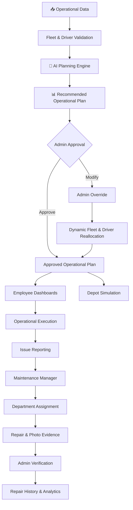

# 🚆 KO-NECT | Unified Metro & Water Metro Operations Control System

### Connecting Operations. Optimizing Mobility. Empowering Decisions.

**A unified operational decision-support platform inspired by Kochi Metro Rail and Kochi Water Metro operations.**

---

## 🌆 About KO-NECT

Urban transportation involves thousands of interconnected decisions involving fleet availability, employee allocation, maintenance, passenger demand, and unexpected events.

**KO-NECT** is designed to bring these operational activities together into one intelligent platform.

It combines AI-assisted operational planning, fleet management, workforce allocation, maintenance coordination, and analytical reporting to support smarter decision-making across metro rail and water metro operations.

Rather than managing two transportation networks independently, KO-NECT provides a unified operational perspective.

## ✨ Core Capabilities

| Module | Capabilities |
|---|---|
| 🚆 Metro Operations | Train induction, fleet status and deployment |
| 🚤 Water Metro Operations | Boat allocation, availability and scheduling |
| 🤖 AI Planning | Constraint-based operational recommendations |
| 👨‍✈️ Workforce Management | Driver allocation, shifts and fatigue monitoring |
| 🗓️ Event Intelligence | Event-aware scheduling and extended services |
| 🔧 Maintenance Management | Department assignments and repair workflows |
| 📸 Repair Evidence | Before/after photos and repair documentation |
| 📚 Repair History | Centralized maintenance audit records |
| 📊 Analytics | Ridership, fleet utilization and operational KPIs |
| 📄 Reporting | Downloadable PDF and Excel reports |
| 🏢 Depot Simulation | Fleet failure and maintenance capacity scenarios |
| 🌐 Multilingual | English and Malayalam |
| 🌙 Dark Mode | Alternative operational dashboard theme |

## 🧠 AI-Powered Operational Planning

KO-NECT uses a constraint-based decision-support approach inspired by Operations Research principles.

The planning engine considers multiple operational factors before generating recommendations.

**Planning Inputs**
- Historical passenger ridership
- Train and boat availability
- Maintenance schedules
- Driver and crew availability
- License and certificate validity
- Weekday, weekend and holiday demand
- Special events and expected crowd

**Planning Outputs**
- Recommended fleet deployment
- Driver and crew allocation
- Standby fleet requirements
- Maintenance constraints
- Event-based operational adjustments
- Extended service recommendations

The system also supports administrator overrides and dynamic manpower recalculation.

## 🔄 Operational Workflow

## 🔧 Maintenance Management System

A dedicated Maintenance Manager role coordinates maintenance activities across departments.

**Department Coordination**
- Mechanical
- Electrical
- Civil Works
- IT / Signalling
- Safety
- Housekeeping
- Metro Technical
- Water Metro Technical

**Issue Lifecycle**

`Reported → Assigned → Accepted → In Progress → Testing → Resolved → Verified → Closed`

Every completed repair can include:
- Repair description and technician details
- Spare parts consumed
- Before and after photographs
- Testing results
- Admin verification
- Permanent repair history

## 📊 Operational Intelligence

KO-NECT brings operational analytics into one place.

- Daily passenger ridership trends
- Metro and Water Metro fleet utilization
- Driver availability and shift distribution
- Maintenance and repair trends
- Certificate expiry monitoring
- Department performance
- Event-based operational impact

Administrators can generate and download structured operational reports in PDF and Excel formats.

## 🛠️ Technology Stack

| Technology | Purpose |
|---|---|
| React.js | Component-based frontend |
| Vite | Development and build tooling |
| Tailwind CSS | UI styling and responsive layouts |
| JavaScript / TypeScript | Application logic |
| React Context API | Shared application state |
| Charting Libraries | Analytics and data visualization |
| Excel / JSON | Structured operational input data |
| PDF / Excel Libraries | Report generation |

*The implementation should be updated to reflect the exact libraries and integrations in the current repository.*

## 🌐 Multilingual Experience

KO-NECT supports two languages:

- 🇬🇧 English
- 🇮🇳 മലയാളം (Malayalam)

The language preference extends across dashboards, operational data, event notices, schedules, alerts and downloadable reports.

## 👥 Role-Based Dashboards

**1. Admin – Operations Control Center**
- Central operational monitoring
- AI planning and approval
- Fleet and driver management
- Event scheduling
- Maintenance oversight
- Analytics and reporting

**2. Metro Employee**
- Train assignments
- Shift schedules
- Operational instructions
- Special event notices
- Issue reporting

**3. Water Metro Employee**
- Boat assignments
- Captain and crew schedules
- Operational instructions
- Event-based service updates
- Issue reporting

**4. Maintenance Manager**
- Department coordination
- Repair work queue
- Maintenance status updates
- Repair evidence uploads
- Repair history and reports

## 🎯 Project Objectives

- Reduce manual operational planning effort.
- Improve fleet and workforce utilization.
- Coordinate metro and water metro operations.
- Incorporate special events into service planning.
- Improve maintenance traceability.
- Support transparent, data-driven decisions.

## 🚀 Future Scope

- Real-time IoT integration with metro and boat systems.
- Live GPS-based fleet monitoring.
- Predictive maintenance using historical operational data.
- Machine learning-based passenger demand forecasting.
- Integration with enterprise maintenance management systems.
- Automated operational data ingestion through APIs.

## 🏆 Achievement

🥈 **Second Prize – TECHYUGAM '26**

Inter-College Project Expo  
Vel Tech Multi Tech Dr. Rangarajan Dr. Sakunthala Engineering College

## 👨‍💻 Project Team

### METRO BOYS

| Team Member |
|---|
| Sam Punitha Raj D |
| Vishnu Vardan E |
| Srivarsan JP |
| Vidur Varshan V |

**St. Joseph's College of Engineering, Chennai**

---

### 🚆 KO-NECT

**One Network. Two Mobility Systems. One Intelligent Platform.**

*Transforming transportation operations through connected decision-making.*

