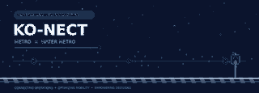
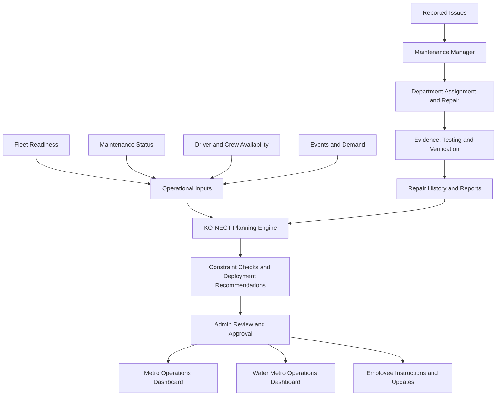

<div align="center">



<a href="https://readme-typing-svg.demolab.com"></a>

<br/>


<br/><br/>

### **CONNECTING OPERATIONS · OPTIMIZING MOBILITY · EMPOWERING DECISIONS**

*A unified operations and decision-support platform for Kochi Metro and Kochi Water Metro.*

</div>

---

## 🛰️ 01 / THE BIG PICTURE

**KO-NECT** brings Metro and Water Metro operations into one coordinated workspace. It is designed to help operations teams plan fleet deployment, coordinate drivers and crew, respond to service disruptions, manage maintenance, and understand daily operational performance.

Instead of treating fleet planning, staffing, maintenance, and service updates as isolated activities, KO-NECT connects them through a shared operational workflow.

<div align="center">

| 🚆 METRO OPERATIONS | ⛴️ WATER METRO OPERATIONS | 🧠 UNIFIED CONTROL |
|:---:|:---:|:---:|
| Trainset readiness and deployment | Boat readiness and deployment | One operations workspace |
| Driver and shift coordination | Captain and crew coordination | Shared planning visibility |
| Depot and maintenance status | Fleet and route readiness | Centralized monitoring |

</div>

## ⚙️ 02 / WHAT KO-NECT BRINGS TOGETHER

### 🚦 AI-Assisted Operational Planning

- Generate daily fleet deployment recommendations for Metro and Water Metro.
- Consider vehicle readiness, maintenance status, mandatory checks, and available manpower before recommending deployment.
- Allocate drivers, captains, and crew against operational requirements and shift availability.
- Allow administrators to review, edit, and approve the recommended plan.
- Recalculate related allocations when an approved operational change affects fleet availability.

### 📅 Event-Aware Service Planning

- Include calendar events and expected crowd levels in operational planning.
- Support increased service demand through additional deployment and manpower planning.
- Highlight event-related instructions and service changes for relevant employees.
- Account for pre-event, event-time, and post-event operational requirements.

### 🛠️ Maintenance Coordination

- Route reported issues to the Maintenance Manager for department assignment.
- Coordinate work across Mechanical, Electrical, Civil Works, IT/Signalling, Safety, Housekeeping, Metro Technical, and Water Metro Technical teams.
- Track repair progress from reporting and assignment through testing, verification, and closure.
- Maintain repair notes, technician details, parts used, and before/after evidence.
- Keep repair history available for operational review and maintenance reporting.

### 📊 Reports and Operational Intelligence

- Bring fleet status, daily operations, staffing, maintenance, and event impact into a reporting workspace.
- Present operational indicators and trends for review.
- Support report exports where enabled in the application.
- Give administrators a consolidated view for operational decisions.

### 🌐 Role-Based and Bilingual Experience

- Separate operational views for administrators, Metro employees, Water Metro employees, and maintenance coordination.
- Provide English and Malayalam language support across the application interface.
- Include dark-mode support and a consistent dashboard experience.

---

## 🧩 03 / HOW THE WORKFLOW CONNECTS



---

## 🔄 04 / MAINTENANCE LIFECYCLE

<div align="center">

`REPORTED` → `ASSIGNED` → `ACCEPTED` → `IN PROGRESS` → `TESTING` → `RESOLVED` → `VERIFIED` → `CLOSED`

</div>

Each stage gives the responsible team a clearer view of the issue, its owner, repair progress, evidence, and verification status. Completed work can also contribute to the centralized repair history.

---

## 🖥️ 05 / PLATFORM MODULES

| Module | Purpose |
|---|---|
| **Admin Control Center** | Central operational overview, approvals, planning, and monitoring |
| **AI Planning** | Fleet deployment recommendations and operational re-planning |
| **Metro Employee Dashboard** | Train-related assignments, shifts, and service instructions |
| **Water Metro Employee Dashboard** | Boat-related assignments, crew coordination, and service instructions |
| **Maintenance Manager** | Department coordination, work queue, repair evidence, and history |
| **Driver and Crew Management** | Workforce availability, shift planning, and allocation visibility |
| **Reports Center** | Operational summaries, maintenance insights, and downloadable reports |
| **Analytics** | Fleet, workforce, maintenance, and service-performance indicators |

---

## 🧰 06 / TECHNOLOGY

<div align="center">


</div>

| Layer | Technology |
|---|---|
| Frontend | React 18 + TypeScript |
| Development and build | Vite 5 |
| Styling | Tailwind CSS 3 |
| Backend services | Supabase |
| Data visualization | Recharts |
| Icons | Lucide React |
| Source control | Git and GitHub |

---

## 🚀 07 / GETTING STARTED

Clone the repository and install the project dependencies:

```bash
git clone https://github.com/SamPunithaRajD/Ko-nect-Metro.git
cd Ko-nect-Metro
npm install
npm run dev
```

Use the local URL printed by Vite to open the application.

---

## 🎯 08 / PROJECT OBJECTIVE

KO-NECT explores how a connected digital platform can improve the coordination of two public-transport networks. Its goal is to make operational decisions more visible, structured, and responsive by connecting fleet readiness, workforce allocation, maintenance activity, and changing passenger demand.

**The focus is not only on displaying information — it is on helping teams act on it.**

---

## 🏆 09 / RECOGNITION

<div align="center">

### 🥈 SECOND PRIZE — TECHYUGAM '26

Inter-College Project Expo  ·  Vel Tech Multi Tech Dr. Rangarajan Dr. Sakunthala Engineering College

</div>

---

## 👨‍💻 10 / THE TEAM — METRO BOYS

| Name | Role |
|---|---|
| **Sam Punitha Raj D** | Team Member |
| **Vishnu Vardan E** | Team Member |
| **Srivarsan JP** | Team Member |
| **Vidur Varshan V** | Team Member |

**Institution:** St. Joseph's College of Engineering, Chennai  
**Project:** KO-NECT — KMRL Unified Operations Control System

---

## 🌐 11 / VISION

A more connected transit ecosystem where operational data, people, vehicles, and decisions work together.

<div align="center">

### **ONE NETWORK OF INFORMATION. TWO MODES OF MOBILITY. ONE CONNECTED EXPERIENCE.**


</div>
